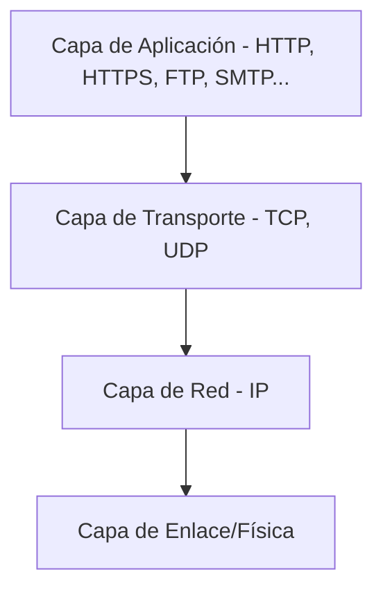
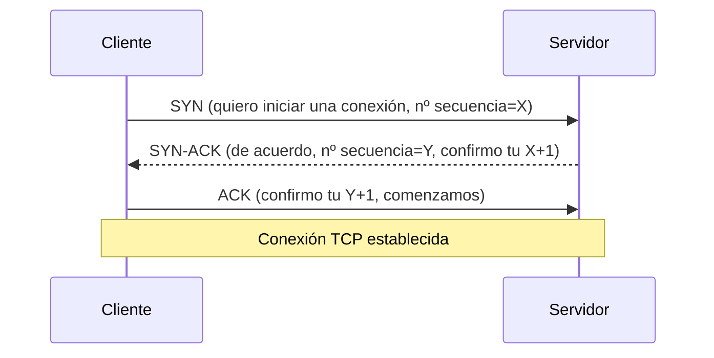
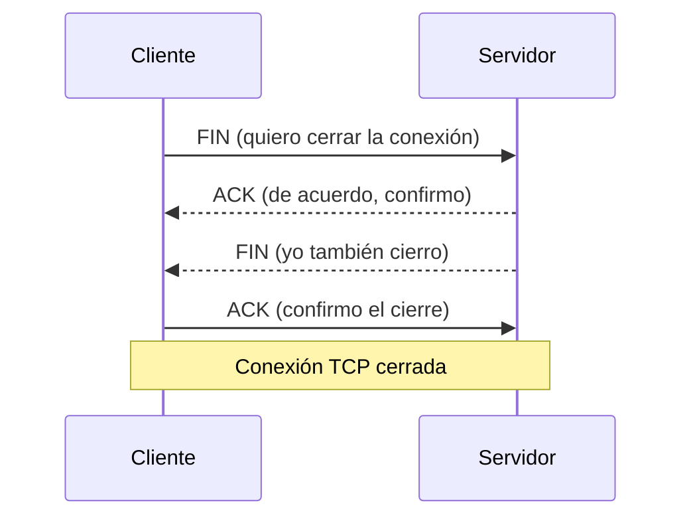
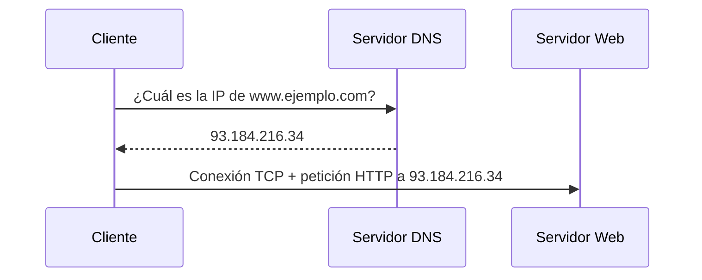
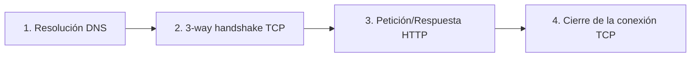

<!-- filepath: /home/lenovo-carles/GithubDAW/Apuntes-Despliegue-de-Aplicaciones-Web/docs/UD02 - WWW y protocolo HTTP/3. Protocolos de internet.md -->
# Protocolos de Internet

Para que dos máquinas puedan comunicarse a través de internet es necesario que compartan un conjunto de reglas: los **protocolos**. En este apartado veremos cómo se organizan estos protocolos en capas y cómo se establece una conexión fiable antes de poder enviar ninguna petición web.

## El modelo TCP/IP

Las comunicaciones en internet se organizan en una pila de capas, donde cada una se apoya en la anterior:

- **Capa de aplicación**: protocolos que usan directamente las aplicaciones (HTTP, HTTPS, FTP, SMTP, DNS...).
- **Capa de transporte**: garantiza (o no) la entrega fiable de los datos. Los dos protocolos principales son **TCP** (fiable, orientado a conexión) y **UDP** (más rápido, sin garantías).
- **Capa de red**: encargada del direccionamiento mediante **IP** (direcciones IPv4/IPv6) y el enrutamiento entre redes.
- **Capa de enlace/física**: transmisión de los bits sobre el medio físico (cable, fibra, WiFi...).

## TCP vs UDP

| Característica       | TCP                          | UDP                        |
|------------------------|-------------------------------|-------------------------------|
| Orientado a conexión    | Sí                             | No                             |
| Fiabilidad              | Garantiza la entrega y el orden | No garantiza nada              |
| Velocidad               | Más lento (por el control)    | Más rápido                     |
| Uso típico              | HTTP, HTTPS, FTP, SSH, email  | Streaming, VoIP, DNS, juegos online |

HTTP y HTTPS, los protocolos en los que nos centraremos en esta unidad, funcionan siempre sobre **TCP**, ya que necesitan garantías de que los datos lleguen completos y en orden.

## Direcciones IP y puertos

Cada equipo conectado a una red dispone de una **dirección IP** que lo identifica. Además, cada servicio que se ejecuta en ese equipo escucha en un **puerto** concreto:

- Puerto **80**: HTTP (sin cifrar).
- Puerto **443**: HTTPS (cifrado).
- Puerto **22**: SSH.
- Puerto **21**: FTP.

Una conexión queda identificada de forma única mediante el conjunto `(IP origen, puerto origen, IP destino, puerto destino, protocolo)`.

## Establecimiento de una conexión TCP: el saludo de tres vías (*3-way handshake*)

Antes de poder enviar ninguna petición HTTP, el cliente y el servidor deben establecer primero una **conexión TCP fiable**, mediante el intercambio de tres mensajes:

- **SYN** (*synchronize*): el cliente indica al servidor que quiere iniciar una conexión y le propone un número de secuencia inicial.
- **SYN-ACK**: el servidor confirma (*ACK*) la petición del cliente y, a su vez, propone su propio número de secuencia (*SYN*).
- **ACK** (*acknowledge*): el cliente confirma la respuesta del servidor. A partir de aquí la conexión queda establecida y pueden empezar a intercambiarse datos.

## Cierre de una conexión TCP

Una vez terminada la comunicación, la conexión se cierra también mediante un intercambio de mensajes (*4-way handshake* o terminación con `FIN`/`ACK`):

## DNS: traduciendo nombres a direcciones IP

Los humanos no recordamos direcciones IP, sino nombres de dominio (`www.ejemplo.com`). El protocolo **DNS (Domain Name System)** se encarga de traducir esos nombres a direcciones IP:

Este proceso ocurre **antes** del *3-way handshake*, ya que el cliente necesita conocer la IP de destino para poder iniciar la conexión TCP.

## Resumen del flujo completo

En el siguiente apartado veremos **actividades prácticas** para afianzar estos conceptos, y posteriormente entraremos en detalle en el funcionamiento del protocolo **HTTP** y su versión segura **HTTPS**.
