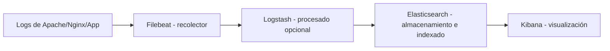

<!-- filepath: /home/lenovo-carles/GithubDAW/Apuntes-Despliegue-de-Aplicaciones-Web/docs/UD04 - Gestión Avanzada de Servidores Web/10. Gestión y monitorización de logs.md -->
# Gestión y monitorización de logs

Los **logs** (registros) son la principal fuente de información para detectar errores, analizar el comportamiento del servidor y responder ante incidentes de seguridad. En servidores con mucho tráfico o varios componentes, revisar los logs "a mano" no es viable, por lo que se recurre a **herramientas de gestión de logs**.

## Logs generados por Apache

Por defecto, Apache genera dos ficheros principales:

```bash
sudo tail -f /var/log/apache2/access.log
sudo tail -f /var/log/apache2/error.log
```

- **access.log**: registra todas las peticiones recibidas (IP, fecha, método, recurso solicitado, código de estado, user-agent...).
- **error.log**: registra errores de configuración, fallos de módulos, problemas con scripts, etc.

### Formato de log personalizado

Apache permite definir el formato del log de acceso mediante la directiva `LogFormat`:

```text
LogFormat "%h %l %u %t \"%r\" %>s %b \"%{Referer}i\" \"%{User-Agent}i\"" combined
CustomLog ${APACHE_LOG_DIR}/access.log combined
```

| Marcador | Significado                         |
|----------|--------------------------------------|
| `%h`     | IP del cliente                      |
| `%u`     | Usuario autenticado (si lo hay)     |
| `%t`     | Fecha y hora de la petición          |
| `%r`     | Línea de la petición (método, recurso, protocolo) |
| `%>s`    | Código de estado HTTP devuelto      |
| `%b`     | Tamaño de la respuesta en bytes     |

### Rotación de logs

Para evitar que los logs crezcan indefinidamente, se usa **logrotate**, que los rota, comprime y elimina periódicamente:

```text
/var/log/apache2/*.log {
    weekly
    rotate 12
    compress
    missingok
    notifempty
}
```

## Por qué centralizar y analizar logs

Cuando existen varios servidores, contenedores o aplicaciones, cada uno genera sus propios logs de forma independiente. Centralizarlos permite:

- Buscar información de forma unificada sin conectarse a cada servidor por separado.
- Correlacionar eventos entre distintos componentes (web, base de datos, balanceador...).
- Generar **alertas automáticas** ante patrones sospechosos (muchos errores 500, intentos de login fallidos repetidos...).
- Crear **paneles (dashboards)** visuales con métricas de tráfico, errores y rendimiento.

## Stack ELK / Elastic Stack

Una de las soluciones más utilizadas para la gestión de logs es el **Elastic Stack**, formado por:



- **Filebeat**: agente ligero instalado en cada servidor que envía los logs al siguiente componente.
- **Logstash**: procesa, filtra y transforma los logs (parseo de campos, enriquecimiento...).
- **Elasticsearch**: motor de búsqueda e indexado donde se almacenan los logs ya procesados.
- **Kibana**: interfaz web para consultar los logs y crear dashboards.

### Ejemplo de configuración básica de Filebeat

```yaml
filebeat.inputs:
  - type: log
    paths:
      - /var/log/apache2/access.log
      - /var/log/apache2/error.log

output.elasticsearch:
  hosts: ["localhost:9200"]
```

## Alternativas al Elastic Stack

- **Grafana Loki**: sistema de logs ligero pensado para integrarse con Grafana, muy usado junto a Prometheus.
- **Graylog**: plataforma de gestión de logs open-source con interfaz propia, alternativa a Kibana.
- **CloudWatch Logs (AWS)** / **Azure Monitor Logs**: soluciones gestionadas por el proveedor de nube, útiles cuando el servidor ya está desplegado en ese entorno.

## Monitorización en tiempo real

Además de almacenar y consultar logs, es habitual monitorizar **métricas** del servidor en tiempo real:

- **Prometheus**: recolecta métricas (CPU, memoria, peticiones por segundo, latencia...) exponiendo un endpoint `/metrics`.
- **Grafana**: visualiza esas métricas en dashboards interactivos y permite configurar alertas.
- **mod_status de Apache**: módulo que expone una página con el estado actual del servidor:

```text
<Location /server-status>
    SetHandler server-status
    Require ip 127.0.0.1
</Location>
```

```bash
sudo a2enmod status
sudo systemctl reload apache2
curl http://localhost/server-status
```

## Buenas prácticas en la gestión de logs

- Configurar siempre la **rotación de logs** para evitar llenar el disco.
- No registrar información sensible (contraseñas, tokens) en los logs.
- Centralizar los logs cuando existan múltiples servidores o contenedores.
- Definir **alertas** ante patrones anómalos (picos de errores 5xx, múltiples intentos de autenticación fallidos desde la misma IP...).
- Establecer una **política de retención** de logs acorde a los requisitos legales (por ejemplo, el ENS exige conservar ciertos registros durante un periodo mínimo).
