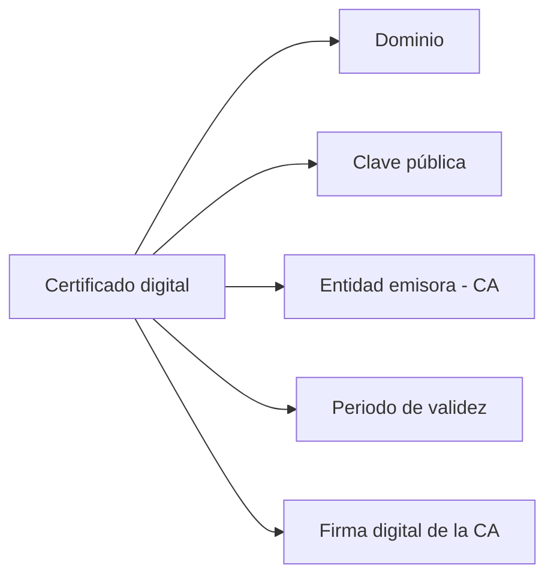
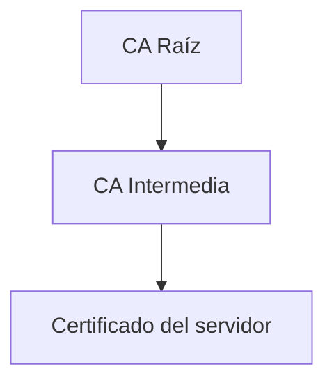
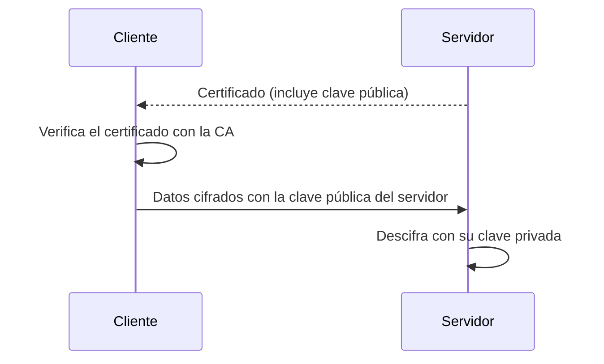

<!-- filepath: /home/lenovo-carles/GithubDAW/Apuntes-Despliegue-de-Aplicaciones-Web/docs/UD04 - Gestión Avanzada de Servidores Web/3. Certificados digitales.md -->
# Certificados digitales

Para poder configurar HTTPS en un servidor Apache es necesario disponer de un **certificado digital**. En este apartado veremos qué son, cómo funcionan y cómo obtenerlos.

## ¿Qué es un certificado digital?

Un **certificado digital (X.509)** es un documento electrónico que vincula una **clave pública** con la identidad de una entidad (una persona, una organización o, en el caso de la web, un dominio). Contiene, entre otros datos:

- El **dominio** (o dominios) para el que es válido.
- La **clave pública** del servidor.
- La **entidad emisora** (Autoridad de Certificación o CA).
- El **periodo de validez** (fecha de emisión y caducidad).
- La **firma digital** de la CA que garantiza su autenticidad.



## Autoridades de Certificación (CA)

Una **Autoridad de Certificación** es una entidad de confianza que verifica la identidad del solicitante y emite certificados firmados digitalmente. Los navegadores y sistemas operativos incorporan una lista de CAs **de confianza**; si un certificado ha sido firmado por una de ellas (directa o indirectamente, mediante una cadena de confianza), se considera válido.

### Cadena de confianza



- **CA Raíz**: máxima autoridad, su certificado viene preinstalado en el navegador/sistema operativo.
- **CA Intermedia**: emitida y firmada por la CA raíz, firma a su vez certificados de servidores.
- **Certificado de servidor**: el que realmente se instala en nuestro Apache.

## Tipos de certificados según el proveedor

| Tipo                    | Validación                       | Coste        | Ejemplo               |
|---------------------------|--------------------------------------|----------------|--------------------------|
| Autofirmado              | Ninguna (lo firma uno mismo)        | Gratis         | `openssl req -x509...`   |
| DV (Domain Validation)    | Se valida que controlas el dominio  | Gratis/bajo    | Let's Encrypt            |
| OV (Organization Validation) | Se valida la organización        | Medio          | Certificados comerciales |
| EV (Extended Validation)  | Validación exhaustiva de la empresa | Alto           | Certificados bancarios   |

## Certificados autofirmados

Un certificado autofirmado está firmado por uno mismo en lugar de por una CA reconocida. Es útil para entornos de **desarrollo/pruebas**, pero el navegador mostrará una advertencia de seguridad ya que no puede verificar la cadena de confianza.

```bash
sudo openssl req -x509 -nodes -days 365 -newkey rsa:2048 \
  -keyout /etc/ssl/private/apache-selfsigned.key \
  -out /etc/ssl/certs/apache-selfsigned.crt
```

Parámetros destacados:

- `-x509`: genera directamente un certificado autofirmado (en lugar de una solicitud).
- `-nodes`: no cifra la clave privada con contraseña.
- `-days 365`: validez de un año.
- `-newkey rsa:2048`: genera también una nueva clave privada RSA de 2048 bits.

## Obtener un certificado válido con Let's Encrypt (Certbot)

**Let's Encrypt** es una Autoridad de Certificación gratuita que emite certificados DV de forma automatizada mediante la herramienta **Certbot**.

```bash
sudo apt install certbot python3-certbot-apache -y
sudo certbot --apache -d www.midominio.com -d midominio.com
```

Certbot se encarga de:

1. Verificar que controlas el dominio (mediante un reto HTTP o DNS).
2. Generar el par de claves y solicitar el certificado a Let's Encrypt.
3. Configurar automáticamente el VirtualHost de Apache para usar HTTPS.
4. Programar la **renovación automática** (los certificados de Let's Encrypt caducan cada 90 días).

```bash
sudo certbot renew --dry-run
```

## Clave pública y clave privada

Todo certificado va acompañado de un par de claves:

- **Clave privada**: se guarda en el servidor, nunca se comparte. Se usa para descifrar y firmar.
- **Clave pública**: se distribuye dentro del certificado. Se usa para cifrar datos que solo el servidor podrá descifrar con su clave privada.



## Comprobar un certificado instalado

```bash
openssl s_client -connect midominio.com:443 -servername midominio.com
```

```bash
openssl x509 -in /etc/ssl/certs/apache-selfsigned.crt -text -noout
```

## Buenas prácticas

- Usar certificados de una **CA reconocida** (Let's Encrypt u otra) en producción.
- Configurar la **renovación automática** y comprobar que efectivamente se ejecuta.
- Proteger la **clave privada** con los permisos adecuados (lectura solo para root).
- Evitar certificados autofirmados fuera de entornos de desarrollo/pruebas.
