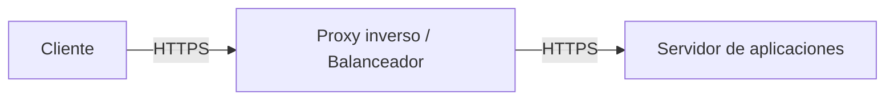

<!-- filepath: /home/lenovo-carles/GithubDAW/Apuntes-Despliegue-de-Aplicaciones-Web/docs/UD04 - Gestión Avanzada de Servidores Web/5. Aseguramiento de las comunicaciones.md -->
# Aseguramiento de las comunicaciones

Además de instalar un certificado, existen varias configuraciones adicionales que permiten **reforzar la seguridad** de las comunicaciones entre cliente y servidor.

## Activar el módulo SSL en Apache

```bash
sudo a2enmod ssl
sudo a2ensite default-ssl
sudo systemctl reload apache2
```

## Forzar la redirección de HTTP a HTTPS

Para evitar que los usuarios naveguen por la versión insegura, se debe redirigir automáticamente todo el tráfico HTTP hacia HTTPS:

```text
<VirtualHost *:80>
    ServerName midominio.com
    Redirect permanent / https://midominio.com/
</VirtualHost>
```

## HSTS (HTTP Strict Transport Security)

La cabecera **HSTS** indica al navegador que, para ese dominio, **nunca** debe usar HTTP, ni siquiera si el usuario escribe la URL sin `https://`. Esto evita ataques de tipo *downgrade* donde se fuerza a la víctima a usar HTTP.

```text
<IfModule mod_headers.c>
    Header always set Strict-Transport-Security "max-age=31536000; includeSubDomains"
</IfModule>
```

- `max-age`: tiempo (en segundos) que el navegador debe recordar esta política.
- `includeSubDomains`: aplica también a todos los subdominios.

## Configurar versiones y cifrados TLS seguros

Es importante deshabilitar versiones antiguas e inseguras de SSL/TLS (como SSLv3 o TLS 1.0) y permitir solo las versiones modernas:

```text
SSLProtocol -all +TLSv1.2 +TLSv1.3
SSLCipherSuite HIGH:!aNULL:!MD5:!3DES
SSLHonorCipherOrder on
```

## Protección frente a ataques comunes

### Ocultar la versión del servidor

Mostrar la versión exacta de Apache facilita a un atacante buscar vulnerabilidades conocidas:

```text
ServerTokens Prod
ServerSignature Off
```

### Limitar los métodos HTTP permitidos

```text
<Location />
    <LimitExcept GET POST HEAD>
        Require all denied
    </LimitExcept>
</Location>
```

### Cabeceras de seguridad adicionales

```text
Header always set X-Content-Type-Options "nosniff"
Header always set X-Frame-Options "SAMEORIGIN"
Header always set Referrer-Policy "strict-origin-when-cross-origin"
```

- **X-Content-Type-Options**: evita que el navegador intente adivinar el tipo de contenido (*MIME sniffing*).
- **X-Frame-Options**: evita que la página se cargue dentro de un `<iframe>` de otro sitio (protección frente a *clickjacking*).
- **Referrer-Policy**: controla qué información se envía en la cabecera `Referer` al navegar a otros sitios.

## Cifrado de extremo a extremo con un proxy inverso

En arquitecturas con balanceador de carga o proxy inverso, conviene asegurar que el cifrado se mantiene **en todo el trayecto**, no solo entre el cliente e el proxy:



Si la conexión entre el proxy y el servidor backend no estuviera cifrada, un atacante con acceso a esa red interna podría interceptar el tráfico.

## Resumen de medidas para asegurar las comunicaciones

- Certificado válido instalado y renovación automática configurada.
- Redirección automática de HTTP a HTTPS.
- Cabecera **HSTS** activada.
- Versiones y cifrados TLS modernos únicamente.
- Cabeceras de seguridad adicionales (`X-Content-Type-Options`, `X-Frame-Options`...).
- Ocultar la información de versión del servidor.
- Cifrado también entre el proxy inverso y el servidor backend.
