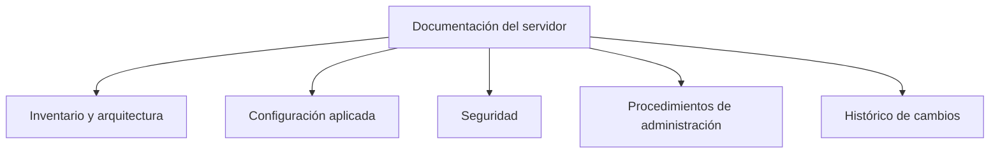

<!-- filepath: /home/lenovo-carles/GithubDAW/Apuntes-Despliegue-de-Aplicaciones-Web/docs/UD04 - Gestión Avanzada de Servidores Web/7. Documentación del servidor.md -->
# Documentación del servidor

Una vez configurado y asegurado el servidor web, es necesario **documentar** todo el trabajo realizado: qué se ha instalado, cómo se ha configurado, qué medidas de seguridad se han aplicado y qué debe tenerse en cuenta para su administración futura. Sin documentación, el conocimiento queda únicamente en la cabeza de quien hizo la configuración, lo que supone un riesgo importante para cualquier organización.

## ¿Por qué documentar?

- Facilita el **mantenimiento** por parte de otras personas (o de uno mismo, meses después).
- Permite **reproducir** la configuración en caso de caída del servidor o migración a otro equipo.
- Es necesaria para **auditorías de seguridad** y cumplimiento normativo (ENS, RGPD, ISO 27001...).
- Reduce el tiempo de resolución de incidencias.

## Qué debe incluir la documentación de un servidor



### 1. Inventario y arquitectura

- Sistema operativo y versión.
- Software instalado (Apache/Nginx, versión, módulos activos).
- Direcciones IP, nombres de dominio y VirtualHosts configurados.
- Diagrama de la arquitectura (servidor único, balanceador, proxy inverso, etc.).

### 2. Configuración aplicada

- Rutas de los ficheros de configuración relevantes (`/etc/apache2/sites-available/*.conf`, `/etc/apache2/apache2.conf`...).
- Módulos habilitados (`a2enmod`) y su propósito.
- Configuración de los VirtualHosts (puertos, `DocumentRoot`, alias...).

### 3. Seguridad

- Mecanismos de autenticación y control de acceso configurados.
- Certificados digitales instalados: entidad emisora, fecha de caducidad y procedimiento de renovación.
- Cabeceras de seguridad aplicadas (HSTS, X-Frame-Options...).
- Política de contraseñas y usuarios con acceso administrativo.

### 4. Procedimientos de administración

- Cómo arrancar, parar, recargar y comprobar el estado del servicio.
- Cómo realizar copias de seguridad de la configuración y del contenido web.
- Cómo renovar certificados manualmente si fallara la renovación automática.
- Procedimiento de despliegue de una nueva versión de la aplicación.

### 5. Histórico de cambios

Un registro cronológico de los cambios realizados, indicando fecha, autor y motivo:

| Fecha       | Autor   | Cambio realizado                              |
|-------------|---------|------------------------------------------------|
| 2024-01-10  | C. Calatayud | Instalación inicial de Apache y configuración de VirtualHost |
| 2024-02-03  | C. Calatayud | Activación de HTTPS con Let's Encrypt         |
| 2024-03-15  | C. Calatayud | Añadida autenticación Basic al panel /admin   |

## Herramientas para documentar

- **Markdown + control de versiones (Git)**: ligero, versionable, fácil de revisar mediante *pull requests*.
- **MkDocs / MkDocs Material**: genera un sitio de documentación navegable a partir de ficheros Markdown (el que se está usando en estos apuntes).
- **Wikis internas** (Confluence, DokuWiki, Wiki.js): útiles en equipos grandes con documentación muy cambiante.
- **Comentarios dentro de los propios ficheros de configuración**, indicando el motivo de cada directiva no evidente:

```text
# Redirige todo el tráfico HTTP a HTTPS (requerido por política de seguridad interna, ticket #245)
Redirect permanent / https://midominio.com/
```

## Recomendaciones de uso del servidor

Además de documentar la configuración, conviene dejar por escrito **recomendaciones de uso** dirigidas a quien administre el servidor en el futuro:

- No modificar directamente los ficheros en producción sin pasar antes por un entorno de pruebas.
- Revisar los logs de error tras cualquier cambio de configuración.
- Mantener el sistema operativo y los paquetes actualizados (`apt update && apt upgrade`).
- Comprobar periódicamente la validez y caducidad de los certificados.
- No deshabilitar mecanismos de seguridad (HSTS, autenticación...) "temporalmente" sin registrar el motivo y revertirlo cuanto antes.

## Buenas prácticas al documentar

- Mantener la documentación **junto al código** (en el propio repositorio) para que evolucione junto a él.
- Usar un lenguaje claro, evitando dar por hecho conocimientos no explicitados.
- Incluir **ejemplos reales** de comandos y configuraciones, no solo descripciones teóricas.
- Revisar y actualizar la documentación cada vez que se realice un cambio relevante en el servidor.
