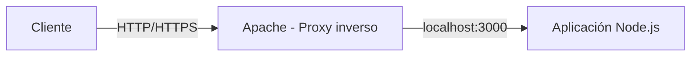

<!-- filepath: /home/lenovo-carles/GithubDAW/Apuntes-Despliegue-de-Aplicaciones-Web/docs/UD04 - Gestión Avanzada de Servidores Web/8. Ajustes para la implantación de aplicaciones.md -->
# Ajustes para la implantación de aplicaciones en el servidor web

Más allá de servir ficheros estáticos, un servidor web suele necesitar ajustes específicos para alojar correctamente una **aplicación** (PHP, Node.js, una SPA de JavaScript, etc.). En este apartado veremos los ajustes más habituales.

## VirtualHosts y organización de aplicaciones

Cuando un servidor aloja varias aplicaciones, cada una suele tener su propio **VirtualHost**, con su `DocumentRoot` y configuración independiente:

```text
<VirtualHost *:80>
    ServerName app1.midominio.com
    DocumentRoot /var/www/app1/public
</VirtualHost>

<VirtualHost *:80>
    ServerName app2.midominio.com
    DocumentRoot /var/www/app2/public
</VirtualHost>
```

!!! tip
    Es buena práctica separar el código de la aplicación (`/var/www/app1`) del `DocumentRoot` público (`/var/www/app1/public`), de modo que ficheros sensibles (`.env`, configuración de base de datos...) **no sean accesibles** directamente desde el navegador.

## Permisos de ficheros y propietario

Una aplicación necesita que Apache (habitualmente el usuario `www-data`) pueda **leer** los ficheros y, en algunos casos (subida de ficheros, cachés, logs de la propia app), también **escribir**:

```bash
sudo chown -R www-data:www-data /var/www/app1
sudo find /var/www/app1 -type d -exec chmod 755 {} \;
sudo find /var/www/app1 -type f -exec chmod 644 {} \;
```

Si existen directorios que la aplicación necesita modificar (por ejemplo `storage/` o `cache/` en frameworks PHP):

```bash
sudo chmod -R 775 /var/www/app1/storage
```

!!! warning
    Nunca usar `chmod -R 777`. Otorga permisos de escritura a **cualquier usuario del sistema**, lo que supone un grave riesgo de seguridad.

## Despliegue de aplicaciones PHP

Para ejecutar código PHP, Apache necesita el módulo correspondiente o trabajar junto a **PHP-FPM**:

```bash
sudo apt install php libapache2-mod-php -y
# o, con PHP-FPM (recomendado, mejor rendimiento):
sudo apt install php-fpm -y
sudo a2enmod proxy_fcgi setenvif
sudo a2enconf php8.1-fpm
sudo systemctl reload apache2
```

Configuración típica del VirtualHost con PHP-FPM:

```text
<VirtualHost *:80>
    ServerName app1.midominio.com
    DocumentRoot /var/www/app1/public

    <FilesMatch \.php$>
        SetHandler "proxy:unix:/run/php/php8.1-fpm.sock|fcgi://localhost"
    </FilesMatch>
</VirtualHost>
```

## Despliegue de aplicaciones Node.js mediante proxy inverso

Apache no ejecuta código Node.js directamente: la aplicación corre en un proceso aparte (por ejemplo con `node app.js` gestionado por **PM2**) escuchando en un puerto local, y Apache actúa como **proxy inverso**:

```bash
sudo a2enmod proxy proxy_http
```

```text
<VirtualHost *:80>
    ServerName app1.midominio.com

    ProxyPreserveHost On
    ProxyPass / http://127.0.0.1:3000/
    ProxyPassReverse / http://127.0.0.1:3000/
</VirtualHost>
```



## Despliegue de una SPA (Single Page Application)

Las aplicaciones de una sola página (React, Vue, Angular...) generan ficheros estáticos (HTML, JS, CSS) tras el proceso de *build*, pero necesitan que **todas las rutas** redirijan a `index.html` para que el enrutado lo gestione JavaScript en el cliente:

```text
<Directory /var/www/app-spa/dist>
    FallbackResource /index.html
</Directory>
```

## Variables de entorno y configuración sensible

Las aplicaciones suelen necesitar configuración sensible (credenciales de base de datos, claves de API...) que **nunca** debe incluirse en el repositorio de código ni quedar accesible públicamente:

- Usar ficheros `.env` fuera del `DocumentRoot` público.
- Configurar reglas que bloqueen el acceso directo a ficheros sensibles:

```text
<FilesMatch "^\.env">
    Require all denied
</FilesMatch>
```

## Compresión y caché de recursos estáticos

```text
<IfModule mod_deflate.c>
    AddOutputFilterByType DEFLATE text/html text/css application/javascript
</IfModule>

<IfModule mod_expires.c>
    ExpiresActive On
    ExpiresByType image/jpg "access plus 1 month"
    ExpiresByType text/css "access plus 1 week"
</IfModule>
```

- `mod_deflate`: comprime las respuestas antes de enviarlas, reduciendo el tiempo de carga.
- `mod_expires`: indica al navegador cuánto tiempo puede mantener en caché un recurso, evitando descargarlo de nuevo.

## Checklist de implantación de una aplicación

- [ ] VirtualHost específico con `DocumentRoot` adecuado.
- [ ] Permisos de ficheros correctos (propietario `www-data`, sin `777`).
- [ ] Módulo o proxy necesario activado según la tecnología (PHP-FPM, `proxy_http`...).
- [ ] Ficheros de configuración sensibles (`.env`) inaccesibles desde el navegador.
- [ ] Compresión y caché de recursos estáticos configuradas.
- [ ] Pruebas de funcionamiento realizadas tras el despliegue.
