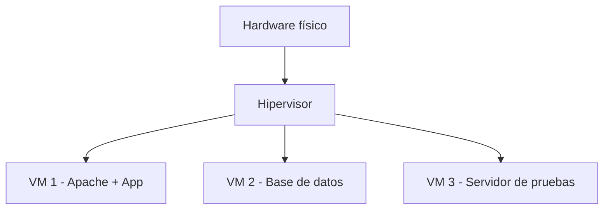
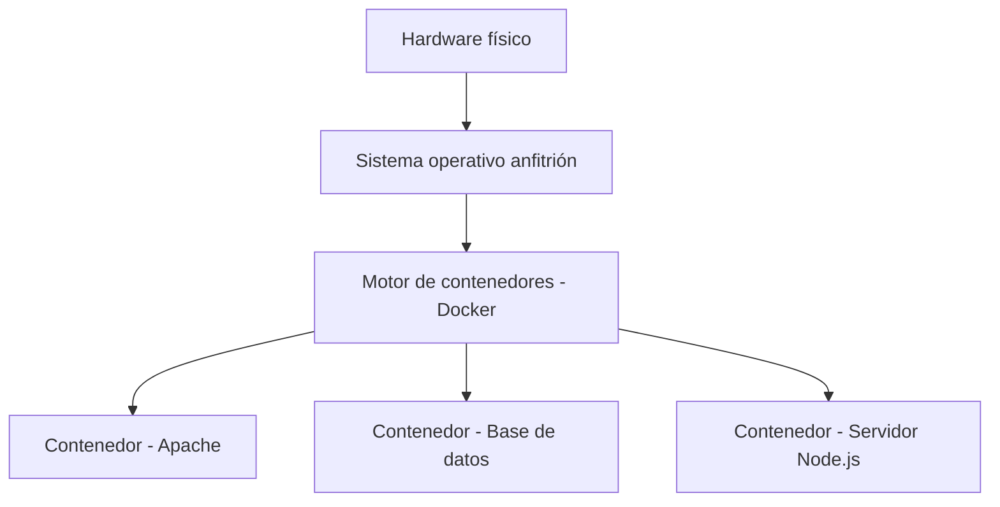
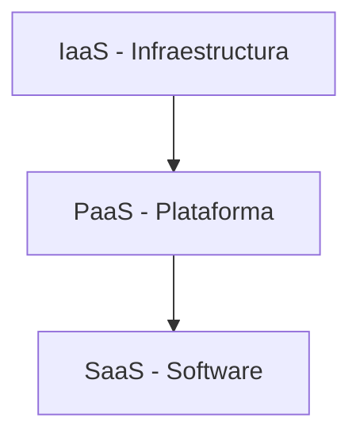
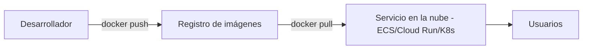

<!-- filepath: /home/lenovo-carles/GithubDAW/Apuntes-Despliegue-de-Aplicaciones-Web/docs/UD04 - Gestión Avanzada de Servidores Web/9. Virtualización y contenedores en la nube.md -->
# Virtualización y contenedores en la nube

Los servidores web modernos rara vez se despliegan directamente sobre hardware físico dedicado. Lo habitual es usar **virtualización** y/o **contenedores**, a menudo en proveedores de **nube** (*cloud*).

## Virtualización tradicional (máquinas virtuales)

Una **máquina virtual (VM)** emula un ordenador completo, con su propio sistema operativo, sobre un **hipervisor** que reparte los recursos físicos del servidor real entre varias VMs.



### Tipos de hipervisor

- **Tipo 1 (bare-metal)**: se ejecuta directamente sobre el hardware. Ej: VMware ESXi, Proxmox, Microsoft Hyper-V, KVM.
- **Tipo 2 (hosted)**: se ejecuta como una aplicación sobre un sistema operativo ya instalado. Ej: VirtualBox, VMware Workstation.

### Ventajas e inconvenientes

| Ventajas                                    | Inconvenientes                         |
|------------------------------------------------|---------------------------------------|
| Aislamiento total entre VMs                     | Mayor consumo de recursos (cada VM tiene su propio SO) |
| Permite ejecutar distintos sistemas operativos  | Arranque más lento                     |
| Snapshots y clonado sencillos                   | Mayor tamaño de las imágenes            |

## Contenedores

Un **contenedor** empaqueta una aplicación junto con sus dependencias, pero **comparte el kernel** del sistema operativo anfitrión, en lugar de emular un SO completo. Esto lo hace mucho más ligero y rápido que una VM.



### Virtualización vs. contenedores

| Característica          | Máquina Virtual         | Contenedor              |
|----------------------------|-----------------------------|------------------------------|
| Aislamiento                | Total (SO independiente)    | A nivel de proceso          |
| Peso                       | Varios GB                   | Decenas/cientos de MB       |
| Tiempo de arranque         | Minutos                     | Segundos                    |
| Portabilidad               | Media                       | Muy alta                    |

## Docker: conceptos básicos

- **Imagen**: plantilla inmutable que contiene el sistema de ficheros y la configuración necesaria para ejecutar una aplicación.
- **Contenedor**: instancia en ejecución de una imagen.
- **Dockerfile**: fichero de texto con las instrucciones para construir una imagen.
- **Registro (registry)**: repositorio de imágenes, como Docker Hub.

### Ejemplo de Dockerfile para Apache

```dockerfile
FROM httpd:2.4
COPY ./public-html/ /usr/local/apache2/htdocs/
EXPOSE 80
```

Construir y ejecutar el contenedor:

```bash
docker build -t miweb-apache .
docker run -d -p 8080:80 --name miweb miweb-apache
```

### Comandos básicos de Docker

```bash
docker ps                  # Contenedores en ejecución
docker images               # Imágenes disponibles
docker logs miweb           # Logs del contenedor
docker exec -it miweb bash  # Acceder a una shell dentro del contenedor
docker stop miweb            # Detener el contenedor
docker rm miweb               # Eliminar el contenedor
```

## Orquestación con Docker Compose

Cuando una aplicación necesita varios contenedores (servidor web + base de datos, por ejemplo), **Docker Compose** permite definirlos y levantarlos todos juntos:

```yaml
services:
  web:
    image: httpd:2.4
    ports:
      - "8080:80"
    volumes:
      - ./public-html:/usr/local/apache2/htdocs
  db:
    image: mysql:8
    environment:
      MYSQL_ROOT_PASSWORD: ejemplo
```

```bash
docker compose up -d
docker compose down
```

## Despliegue en la nube

Los proveedores de nube permiten desplegar servidores web tanto en formato de **máquina virtual** como de **contenedor**, sin necesidad de gestionar el hardware físico.

### Modelos de servicio en la nube



- **IaaS** (Infrastructure as a Service): el proveedor ofrece máquinas virtuales, redes y almacenamiento. Ej: AWS EC2, Azure VM, Google Compute Engine. El administrador instala y configura Apache como si fuera un servidor propio.
- **PaaS** (Platform as a Service): el proveedor gestiona el sistema operativo y el entorno de ejecución; solo se despliega la aplicación. Ej: AWS Elastic Beanstalk, Azure App Service, Heroku.
- **SaaS** (Software as a Service): el software ya viene completamente gestionado por el proveedor (no aplica directamente a servidores web propios).

### Despliegue de contenedores en la nube

- **Docker Hub / Amazon ECR / Azure Container Registry**: almacenan las imágenes construidas.
- **Amazon ECS / Azure Container Instances / Google Cloud Run**: ejecutan contenedores sin gestionar servidores directamente.
- **Kubernetes (K8s)**: orquestador de contenedores a gran escala, capaz de gestionar automáticamente el escalado, la recuperación ante fallos y el balanceo de carga entre múltiples contenedores y nodos.



## Ventajas de usar contenedores y nube para servidores web

- **Escalabilidad**: añadir más instancias del contenedor según la demanda (*autoscaling*).
- **Portabilidad**: el mismo contenedor funciona igual en desarrollo, pruebas y producción.
- **Despliegues reproducibles**: la imagen define exactamente el entorno, evitando el clásico "en mi máquina funciona".
- **Recuperación rápida**: si un contenedor falla, el orquestador puede recrearlo automáticamente en segundos.

## Buenas prácticas

- No incluir credenciales dentro de la imagen; usar variables de entorno o *secrets*.
- Usar imágenes base oficiales y mantenerlas actualizadas (vulnerabilidades).
- Limitar los recursos (CPU/memoria) asignados a cada contenedor.
- Versionar las imágenes (`miweb:1.0`, `miweb:1.1`) en lugar de usar siempre `latest` en producción.
