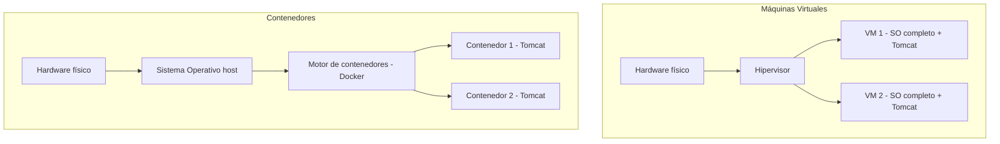
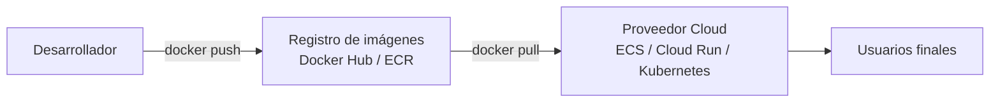

<!-- filepath: /home/lenovo-carles/GithubDAW/Apuntes-Despliegue-de-Aplicaciones-Web/docs/UD04 - Gestión Avanzada de Servidores Web/10. Virtualización y contenedores.md -->
# Virtualización y contenedores

El despliegue de servidores de aplicaciones modernos se apoya cada vez más en tecnologías de **virtualización**, **contenedores** y servicios **cloud**, en lugar de instalar el servidor directamente sobre una máquina física.

## Máquinas virtuales vs contenedores



| Característica         | Máquina Virtual                  | Contenedor (Docker)              |
|---------------------------|---------------------------------------|---------------------------------------|
| Aislamiento                | Total (SO completo por VM)            | A nivel de proceso, comparte el kernel |
| Tamaño                     | Varios GB                             | Varios MB                             |
| Tiempo de arranque         | Minutos                               | Segundos                              |
| Portabilidad               | Media                                 | Muy alta (misma imagen en cualquier entorno) |

## Contenerizar Tomcat con Docker

### Usar la imagen oficial de Tomcat

```bash
docker pull tomcat:10-jdk17
docker run -d -p 8080:8080 --name mi-tomcat tomcat:10-jdk17
```

### Desplegar una aplicación dentro del contenedor

```bash
docker cp miapp.war mi-tomcat:/usr/local/tomcat/webapps/
docker logs -f mi-tomcat
```

### Crear una imagen propia con la aplicación ya incluida (`Dockerfile`)

```dockerfile
FROM tomcat:10-jdk17

# Eliminar las aplicaciones de ejemplo (buena práctica de seguridad)
RUN rm -rf /usr/local/tomcat/webapps/examples \
           /usr/local/tomcat/webapps/docs \
           /usr/local/tomcat/webapps/host-manager

# Copiar nuestra aplicación ya compilada
COPY miapp.war /usr/local/tomcat/webapps/miapp.war

EXPOSE 8080
```

```bash
docker build -t miapp-tomcat:1.0 .
docker run -d -p 8080:8080 --name miapp miapp-tomcat:1.0
```

## Orquestación con Docker Compose

Permite definir y levantar **varios servicios relacionados** (Tomcat + base de datos + proxy) con una sola configuración:

```yaml
version: "3.8"
services:
  tomcat:
    build: .
    ports:
      - "8080:8080"
    depends_on:
      - bd

  bd:
    image: mysql:8
    environment:
      MYSQL_ROOT_PASSWORD: "contraseña"
      MYSQL_DATABASE: "mibasedatos"
    volumes:
      - datos_bd:/var/lib/mysql

volumes:
  datos_bd:
```

```bash
docker compose up -d
```

## Cooperación con Apache HTTP Server en contenedores

El mismo patrón visto anteriormente (Apache como proxy inverso delante de Tomcat) se puede replicar con contenedores, añadiendo un servicio adicional:

```yaml
services:
  apache:
    image: httpd:2.4
    ports:
      - "80:80"
    volumes:
      - ./httpd.conf:/usr/local/apache2/conf/httpd.conf
    depends_on:
      - tomcat

  tomcat:
    build: .
```

## Despliegue en la nube

Las tecnologías de contenedores facilitan el despliegue en proveedores **cloud** (AWS, Azure, Google Cloud):

- **Contenedores gestionados**: servicios como AWS ECS/Fargate, Azure Container Apps o Google Cloud Run permiten ejecutar la imagen Docker de Tomcat sin gestionar servidores directamente.
- **Kubernetes**: orquestador de contenedores a gran escala, capaz de desplegar múltiples réplicas de Tomcat, reiniciarlas automáticamente ante fallos y escalar según la carga.
- **Máquinas virtuales cloud** (EC2, Azure VM, Compute Engine): alternativa más tradicional, instalando Tomcat manualmente como en un servidor físico.



## Ventajas de usar contenedores para el servidor de aplicaciones

- **Reproducibilidad**: la misma imagen funciona igual en desarrollo, pruebas y producción.
- **Escalado sencillo**: levantar más réplicas del contenedor es inmediato.
- **Despliegues y rollbacks rápidos**: basta con cambiar la versión de la imagen desplegada.
- **Aislamiento**: cada aplicación puede tener su propia versión de Tomcat/JVM sin conflictos con otras.

En la práctica final de esta unidad pondremos en marcha un Tomcat contenerizado y realizaremos pruebas de rendimiento sobre él.
