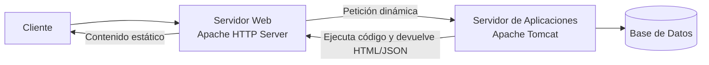
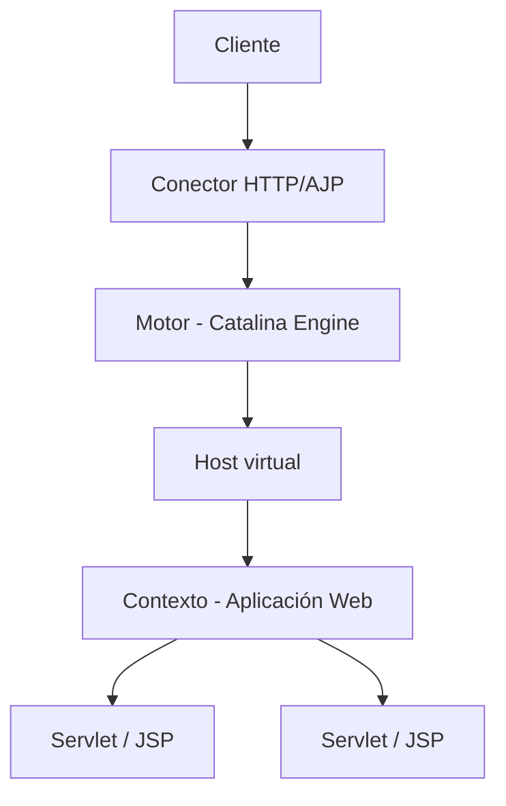
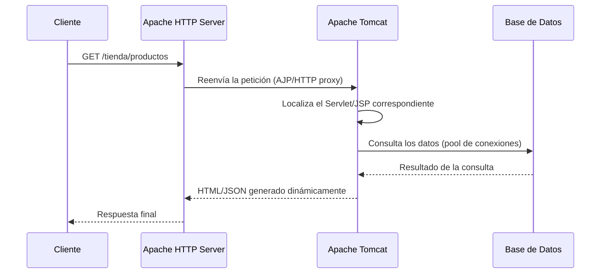

<!-- filepath: /home/lenovo-carles/GithubDAW/Apuntes-Despliegue-de-Aplicaciones-Web/docs/UD04 - Gestión Avanzada de Servidores Web/2. Componentes y funcionamiento.md -->
# Componentes y funcionamiento del servidor de aplicaciones

## Servidor web vs servidor de aplicaciones

Hasta ahora hemos trabajado con **Apache HTTP Server**, un **servidor web**: su función es servir contenido (principalmente **estático**: HTML, CSS, JS, imágenes) a partir de peticiones HTTP.

Un **servidor de aplicaciones** va un paso más allá: es capaz de **ejecutar código** (Java, PHP, Node.js...) para generar contenido **dinámico**, gestionar sesiones de usuario, acceder a bases de datos, aplicar lógica de negocio, etc.

| Característica         | Servidor Web (Apache HTTP)        | Servidor de Aplicaciones (Tomcat)     |
|---------------------------|---------------------------------------|------------------------------------------|
| Contenido que sirve        | Estático (HTML, CSS, JS, imágenes)    | Dinámico (Servlets, JSP, APIs)            |
| Ejecuta código              | No (salvo módulos como `mod_php`)     | Sí (máquina virtual Java, motor de scripts) |
| Gestión de sesiones         | No nativamente                        | Sí                                        |
| Acceso a bases de datos      | No                                    | Sí, mediante *pools* de conexiones         |

## Ejemplos de servidores de aplicaciones

| Servidor         | Lenguaje/Tecnología         |
|-------------------|------------------------------|
| **Apache Tomcat**  | Java (Servlets, JSP)         |
| **Jetty**          | Java (embebido, ligero)      |
| **WildFly/JBoss**  | Java EE completo              |
| **PHP-FPM**        | PHP                           |
| **Node.js**        | JavaScript                   |
| **Gunicorn/uWSGI** | Python                        |

En esta unidad nos centraremos en **Apache Tomcat**, el servidor de aplicaciones Java más utilizado, ligero y de código abierto.

## Arquitectura interna de Tomcat

Tomcat implementa las especificaciones **Servlet** y **JavaServer Pages (JSP)**. Sus componentes principales son:

- **Conector (*Connector*)**: componente que escucha peticiones en un puerto y protocolo determinado. Tomcat puede tener varios conectores simultáneos: **HTTP** (por defecto puerto `8080`) y **AJP** (*Apache JServ Protocol*, puerto `8009`), este último usado para comunicarse con un servidor web como Apache (lo veremos en el tema de cooperación).
- **Motor (*Engine*)**: procesa las peticiones recibidas por los conectores y las dirige al *Host* correspondiente.
- **Host virtual**: permite alojar varias aplicaciones bajo distintos nombres de dominio dentro de un mismo Tomcat (similar a los VirtualHost de Apache).
- **Contexto (*Context*)**: representa una **aplicación web** concreta desplegada (normalmente un fichero `.war`), con su propia ruta base (ej. `/miapp`).
- **Servlets / JSP**: las unidades de código que realmente procesan las peticiones y generan la respuesta.

## Servicios proporcionados por un servidor de aplicaciones

- **Gestión del ciclo de vida de las aplicaciones**: arrancar, detener, recargar aplicaciones sin reiniciar todo el servidor.
- **Gestión de sesiones HTTP**: mantiene el estado de un usuario entre peticiones mediante cookies de sesión (`JSESSIONID` en Tomcat).
- **Pool de conexiones a bases de datos**: reutiliza conexiones ya abiertas en lugar de crear una nueva por cada petición, mejorando el rendimiento.
- **JNDI (*Java Naming and Directory Interface*)**: permite registrar recursos (como fuentes de datos) con un nombre lógico, accesible desde la aplicación sin *hardcodear* credenciales.
- **Seguridad**: autenticación, autorización basada en roles, gestión de certificados.
- **Balanceo de carga y clustering**: posibilidad de ejecutar varias instancias de Tomcat y repartir la carga entre ellas.

## Flujo completo de una petición a una aplicación Java

En los siguientes apartados profundizaremos en los ficheros de configuración de Tomcat, cómo hacer que coopere con Apache HTTP Server, su seguridad, sus componentes web, el despliegue de aplicaciones y las pruebas de funcionamiento.
