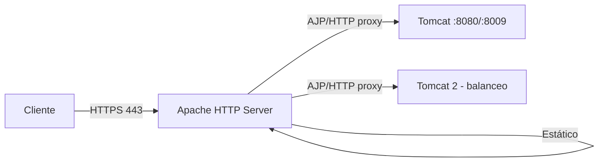

<!-- filepath: /home/lenovo-carles/GithubDAW/Apuntes-Despliegue-de-Aplicaciones-Web/docs/UD04 - Gestión Avanzada de Servidores Web/4. Cooperación con el servidor web.md -->
# Cooperación con el servidor web

En producción, es muy habitual colocar **Apache HTTP Server delante de Tomcat**, en lugar de exponer Tomcat directamente a internet. Esto se conoce como usar Apache como **proxy inverso** del servidor de aplicaciones.

## ¿Por qué hacer cooperar ambos servidores?

- **Apache sirve el contenido estático** (imágenes, CSS, JS) de forma más eficiente, descargando a Tomcat de esa tarea.
- **Apache centraliza HTTPS/TLS**, los certificados y las cabeceras de seguridad (como vimos en el tema de aseguramiento de las comunicaciones).
- Permite colocar **varias aplicaciones/servidores de aplicaciones** detrás de un mismo punto de entrada, repartiendo peticiones según la ruta (`/tienda` → Tomcat A, `/blog` → Tomcat B).
- Facilita el **balanceo de carga** entre varias instancias de Tomcat.



## Opción 1: `mod_proxy` + `mod_proxy_http` (recomendada)

Es la opción más moderna y sencilla: Apache reenvía las peticiones a Tomcat mediante **HTTP normal** sobre el conector `8080`.

### Activar los módulos necesarios

```bash
sudo a2enmod proxy
sudo a2enmod proxy_http
sudo systemctl reload apache2
```

### Configurar el VirtualHost

```text
<VirtualHost *:80>
    ServerName miapp.midominio.com

    ProxyPreserveHost On
    ProxyPass / http://localhost:8080/
    ProxyPassReverse / http://localhost:8080/
</VirtualHost>
```

- **`ProxyPreserveHost On`**: conserva la cabecera `Host` original en la petición reenviada a Tomcat.
- **`ProxyPass`**: redirige todo el tráfico recibido en `/` hacia Tomcat.
- **`ProxyPassReverse`**: reescribe las cabeceras de redirección que pudiera generar Tomcat, para que apunten de vuelta a Apache y no directamente a Tomcat.

### Redirigir solo una ruta concreta (varias aplicaciones)

```text
<VirtualHost *:80>
    ServerName midominio.com

    ProxyPass /tienda http://localhost:8080/tienda
    ProxyPassReverse /tienda http://localhost:8080/tienda

    DocumentRoot /var/www/html
</VirtualHost>
```

De esta forma, `/tienda` se sirve desde Tomcat, mientras que el resto del dominio sigue sirviendo contenido estático directamente desde Apache.

## Opción 2: `mod_jk` con el protocolo AJP

**`mod_jk`** es el conector tradicional entre Apache y Tomcat, que usa el protocolo **AJP** (*Apache JServ Protocol*, puerto `8009`), diseñado específicamente para la comunicación entre ambos servidores y algo más eficiente que un proxy HTTP genérico.

```bash
sudo apt install libapache2-mod-jk -y
```

Fichero `/etc/libapache2-mod-jk/workers.properties`:

```text
worker.list=tomcat1
worker.tomcat1.type=ajp13
worker.tomcat1.host=localhost
worker.tomcat1.port=8009
```

Configuración en el VirtualHost:

```text
<VirtualHost *:80>
    ServerName miapp.midominio.com
    JkMount /* tomcat1
</VirtualHost>
```

!!! warning "AJP y el CVE-2020-1938 (Ghostcat)"
    El conector AJP tuvo una vulnerabilidad grave (*Ghostcat*) si se exponía sin protección adicional. Si se usa AJP, es importante **no exponer el puerto 8009 a internet** y mantener Tomcat actualizado, o bien optar directamente por la opción de `mod_proxy_http`, más simple de asegurar.

## Comparativa de ambas opciones

| Característica          | `mod_proxy_http`          | `mod_jk` (AJP)                |
|----------------------------|-------------------------------|----------------------------------|
| Protocolo usado             | HTTP                          | AJP (binario, optimizado)        |
| Complejidad de configuración | Baja                          | Media (fichero `workers.properties`) |
| Rendimiento                 | Bueno                         | Ligeramente mejor en alta carga   |
| Uso recomendado actual       | **Sí**, opción por defecto    | Entornos heredados/legacy          |

## Comprobación de la cooperación entre servidores

```bash
# Comprobar que Tomcat responde directamente
curl -I http://localhost:8080

# Comprobar que Apache reenvía correctamente la petición
curl -I http://miapp.midominio.com
```

Ambas peticiones deberían devolver el mismo contenido (o un resultado equivalente), confirmando que Apache está correctamente delegando en Tomcat.

## Balanceo de carga entre varias instancias de Tomcat

```text
<Proxy "balancer://cluster">
    BalancerMember "http://localhost:8080"
    BalancerMember "http://localhost:8081"
</Proxy>

ProxyPass "/" "balancer://cluster/"
ProxyPassReverse "/" "balancer://cluster/"
```

Esta configuración reparte las peticiones entre dos instancias de Tomcat (`8080` y `8081`), lo que permite escalar horizontalmente la aplicación.
