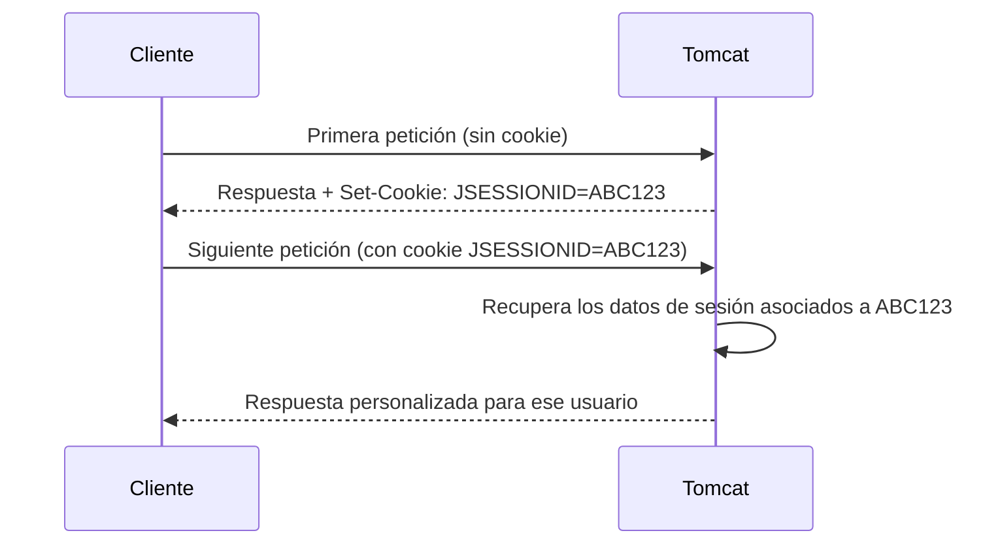

<!-- filepath: /home/lenovo-carles/GithubDAW/Apuntes-Despliegue-de-Aplicaciones-Web/docs/UD04 - Gestión Avanzada de Servidores Web/6. Componentes web.md -->
# Componentes web del servidor de aplicaciones

Una aplicación Java desplegada en Tomcat se estructura siguiendo la especificación **Servlet**, organizada en un paquete llamado **WAR** (*Web Application Archive*).

## Estructura de una aplicación web (WAR)

```text
miapp/
├── index.html
├── css/
├── js/
└── WEB-INF/
    ├── web.xml
    ├── classes/
    │   └── com/ejemplo/MiServlet.class
    └── lib/
        └── libreria-especifica.jar
```

- **`WEB-INF/`**: directorio especial **no accesible directamente** desde el navegador, donde se guarda la configuración y el código compilado de la aplicación.
- **`web.xml`**: descriptor de despliegue de la aplicación (puede faltar si se usan anotaciones Java en su lugar).
- **`classes/`**: clases Java compiladas de la aplicación.
- **`lib/`**: bibliotecas `.jar` usadas **solo** por esta aplicación.

## Servlets

Un **Servlet** es una clase Java que procesa peticiones HTTP y genera una respuesta.

```java
@WebServlet("/saludo")
public class SaludoServlet extends HttpServlet {
    protected void doGet(HttpServletRequest request, HttpServletResponse response)
            throws ServletException, IOException {
        response.setContentType("text/html");
        response.getWriter().println("<h1>Hola desde un Servlet</h1>");
    }
}
```

- `@WebServlet("/saludo")`: mapea la URL `/saludo` a este Servlet.
- `doGet`: método ejecutado cuando se recibe una petición **GET**.

## JSP (JavaServer Pages)

Las **JSP** permiten mezclar HTML con código Java, de forma similar a como PHP mezcla HTML con lógica de servidor.

```jsp
<html>
<body>
    <h1>La hora actual es: <%= new java.util.Date() %></h1>
</body>
</html>
```

Internamente, Tomcat **compila** cada JSP a un Servlet Java la primera vez que se solicita (y lo cachea en el directorio `work/`).

## Filtros (*Filters*)

Los **filtros** interceptan las peticiones antes o después de que lleguen al Servlet, útiles para tareas transversales: logging, compresión, autenticación...

```java
@WebFilter("/*")
public class LogFilter implements Filter {
    public void doFilter(ServletRequest request, ServletResponse response, FilterChain chain)
            throws IOException, ServletException {
        System.out.println("Petición recibida: " + ((HttpServletRequest) request).getRequestURI());
        chain.doFilter(request, response);
    }
}
```

## Listeners

Los **listeners** permiten reaccionar a eventos del ciclo de vida de la aplicación o de la sesión (inicio/parada de la aplicación, creación/destrucción de una sesión...).

```java
@WebListener
public class AppLifecycleListener implements ServletContextListener {
    public void contextInitialized(ServletContextEvent sce) {
        System.out.println("La aplicación se ha iniciado");
    }
}
```

## Gestión de sesiones

Tomcat identifica a cada usuario mediante una cookie de sesión llamada **`JSESSIONID`**:



## Recursos JNDI (fuentes de datos)

En lugar de que cada aplicación defina directamente usuario/contraseña/URL de la base de datos en su código, se puede registrar un recurso JNDI en `context.xml`:

```xml
<Resource name="jdbc/miBD" auth="Container"
          type="javax.sql.DataSource"
          maxTotal="20" maxIdle="10"
          username="usuario_bd" password="contraseña_bd"
          driverClassName="com.mysql.cj.jdbc.Driver"
          url="jdbc:mysql://localhost:3306/mibasedatos"/>
```

Y acceder a él desde el código de la aplicación mediante su nombre lógico (`jdbc/miBD`), sin que la aplicación necesite conocer los detalles de conexión.

## Resumen de componentes web

| Componente   | Función principal                                  |
|---------------|--------------------------------------------------------|
| **Servlet**    | Procesa peticiones HTTP y genera la respuesta            |
| **JSP**        | Mezcla HTML con código Java, compilado a Servlet          |
| **Filter**     | Intercepta peticiones/respuestas para tareas transversales |
| **Listener**   | Reacciona a eventos del ciclo de vida de la app/sesión     |
| **JNDI**       | Registra recursos (como conexiones a BD) con nombre lógico |
