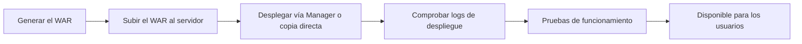

<!-- filepath: /home/lenovo-carles/GithubDAW/Apuntes-Despliegue-de-Aplicaciones-Web/docs/UD04 - Gestión Avanzada de Servidores Web/7. Despliegue de aplicaciones.md -->
# Despliegue de aplicaciones

Una vez desarrollada una aplicación Java web, es necesario **empaquetarla y desplegarla** en el servidor Tomcat. En este apartado veremos las distintas formas de hacerlo.

## El formato WAR

Una aplicación Java web se empaqueta en un fichero **`.war`** (*Web Application Archive*), que no es más que un `.zip` con la estructura de directorios vista en el apartado anterior.

```bash
cd miapp/
jar -cvf miapp.war *
```

## Formas de desplegar una aplicación en Tomcat

### 1. Despliegue automático (*hot deploy*) copiando el WAR

Si el `Host` tiene `autoDeploy="true"` (valor por defecto), basta con copiar el `.war` dentro de `webapps/`:

```bash
sudo cp miapp.war /opt/tomcat/webapps/
```

Tomcat detectará el nuevo fichero, lo descomprimirá automáticamente en una carpeta `miapp/` y desplegará la aplicación, accesible en `http://servidor:8080/miapp`.

### 2. Despliegue mediante el Manager web

Tomcat incluye una aplicación de administración (`/manager`) que permite subir y desplegar un WAR desde el navegador, sin necesidad de acceso por SSH al servidor.

```bash
http://localhost:8080/manager/html
```

Desde ahí se puede:

- Subir un nuevo `.war`.
- **Recargar** (*reload*) una aplicación sin reiniciar todo Tomcat.
- **Detener/arrancar** aplicaciones concretas.
- Consultar el estado y la memoria usada por cada aplicación.

### 3. Despliegue mediante el Manager por línea de comandos (`curl`)

```bash
curl -u admin:contraseña --upload-file miapp.war \
  "http://localhost:8080/manager/text/deploy?path=/miapp&update=true"
```

Esta opción es especialmente útil para **automatizar despliegues** desde un pipeline de integración continua.

### 4. Despliegue como aplicación raíz (`ROOT`)

Si se desea que la aplicación sea accesible directamente en `http://servidor:8080/` (sin ruta adicional), se renombra el WAR a `ROOT.war`:

```bash
sudo rm -rf /opt/tomcat/webapps/ROOT
sudo cp miapp.war /opt/tomcat/webapps/ROOT.war
```

## Ajustes habituales durante el despliegue

### Configurar la ruta de contexto

Se puede indicar la ruta de despliegue sin depender del nombre del fichero, mediante un fichero de contexto específico en `conf/Catalina/localhost/miapp.xml`:

```xml
<Context docBase="/ruta/a/miapp.war" path="/miapp" reloadable="true" />
```

- **`reloadable="true"`**: Tomcat vigila los cambios en las clases compiladas y recarga automáticamente la aplicación (útil en desarrollo, **no recomendado en producción** por el consumo de recursos).

### Variables de entorno y configuración externa

Es una buena práctica **no incluir credenciales dentro del WAR**. En su lugar, se recomienda:

- Definir recursos JNDI en `context.xml` (como vimos en el apartado anterior).
- Usar variables de entorno del sistema operativo, leídas por la aplicación en tiempo de ejecución.

```bash
export DB_PASSWORD="contraseña_segura"
```

### Permisos de ficheros

```bash
sudo chown -R tomcat:tomcat /opt/tomcat/webapps/miapp
```

Es recomendable que Tomcat se ejecute con un usuario dedicado (`tomcat`), y que ese usuario sea propietario de los ficheros desplegados.

## Ciclo de vida típico de un despliegue en producción



## Comandos útiles de administración desde `bin/`

```bash
# Arrancar Tomcat
sudo /opt/tomcat/bin/startup.sh

# Detener Tomcat
sudo /opt/tomcat/bin/shutdown.sh

# Ver el log principal en tiempo real
tail -f /opt/tomcat/logs/catalina.out
```

En el siguiente apartado veremos cómo comprobar que el despliegue ha sido correcto y cómo medir el rendimiento de la aplicación desplegada.
