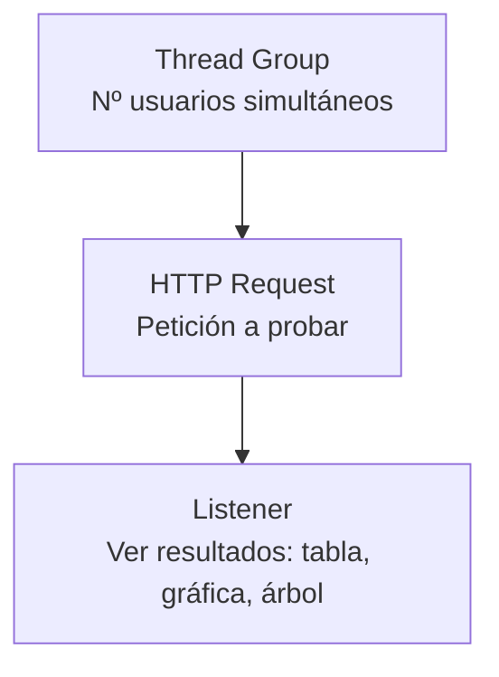

<!-- filepath: /home/lenovo-carles/GithubDAW/Apuntes-Despliegue-de-Aplicaciones-Web/docs/UD04 - Gestión Avanzada de Servidores Web/8. Pruebas de funcionamiento y rendimiento.md -->
# Pruebas de funcionamiento y rendimiento

Tras desplegar una aplicación, es imprescindible comprobar que funciona correctamente y que su rendimiento es adecuado antes de considerarla lista para producción.

## Comprobaciones básicas de funcionamiento

### Comprobar que Tomcat está activo

```bash
sudo systemctl status tomcat
ps aux | grep catalina
```

### Comprobar los puertos en escucha

```bash
sudo ss -tulnp | grep java
```

Deberían aparecer los puertos `8080` (HTTP), `8009` (AJP, si está activo) y `8005` (administración, solo en `localhost`).

### Comprobar la respuesta de la aplicación

```bash
curl -I http://localhost:8080/miapp/
```

### Revisar los logs de despliegue y ejecución

```bash
tail -n 50 /opt/tomcat/logs/catalina.out
tail -n 50 /opt/tomcat/logs/localhost.$(date +%Y-%m-%d).log
```

Un despliegue fallido (por ejemplo, por una excepción Java al arrancar la aplicación) se reflejará en estos logs con una traza de error (*stack trace*).

## Pruebas funcionales con `curl`

```bash
# Comprobar un endpoint concreto
curl -s http://localhost:8080/miapp/saludo

# Comprobar que se mantiene la sesión entre peticiones
curl -c cookies.txt http://localhost:8080/miapp/login
curl -b cookies.txt http://localhost:8080/miapp/perfil
```

- `-c cookies.txt`: guarda las cookies recibidas (incluyendo `JSESSIONID`).
- `-b cookies.txt`: reutiliza esas cookies en la siguiente petición, simulando un mismo usuario.

## Pruebas de carga y rendimiento con Apache JMeter

**Apache JMeter** es una herramienta gráfica (también usable en línea de comandos) diseñada para realizar pruebas de carga sobre aplicaciones web.

### Instalación

```bash
sudo apt install default-jdk -y
wget https://dlcdn.apache.org/jmeter/binaries/apache-jmeter-5.6.3.tgz
tar -xzf apache-jmeter-5.6.3.tgz
```

### Conceptos básicos de un plan de pruebas en JMeter



- **Thread Group**: define cuántos **usuarios virtuales** simultáneos se simulan y cuántas veces repiten la petición.
- **HTTP Request**: la petición concreta a probar (URL, método, parámetros).
- **Listener**: muestra los resultados obtenidos (tiempos de respuesta, errores, gráficas...).

### Ejecución en modo no interactivo (línea de comandos)

```bash
./jmeter -n -t plan_pruebas.jmx -l resultados.jtl
```

- `-n`: modo no interactivo (sin interfaz gráfica), recomendado para pruebas reales de carga.
- `-t`: fichero del plan de pruebas (creado previamente con la interfaz gráfica).
- `-l`: fichero donde se guardan los resultados.

## Pruebas de carga simples con Apache Bench

Para pruebas rápidas y sencillas, también se puede reutilizar **Apache Bench (`ab`)**, visto en la unidad anterior:

```bash
ab -n 500 -c 50 http://localhost:8080/miapp/
```

- `-n 500`: 500 peticiones totales.
- `-c 50`: 50 peticiones simultáneas.

El resultado incluye métricas como:

- **Requests per second**: peticiones por segundo soportadas.
- **Time per request**: tiempo medio de respuesta.
- **Failed requests**: peticiones fallidas (importante que sea 0 o muy bajo).

## Monitorización de recursos durante las pruebas

Mientras se ejecuta una prueba de carga, conviene vigilar el consumo de recursos del servidor:

```bash
htop
```

Y específicamente el uso de memoria de la JVM de Tomcat:

```bash
jstat -gc $(pgrep -f catalina) 1000
```

- **`jstat -gc`**: muestra estadísticas del recolector de basura (*Garbage Collector*) de la JVM, útil para detectar problemas de memoria.

## Checklist de pruebas antes de pasar a producción

- [ ] La aplicación responde correctamente a las rutas principales.
- [ ] Las sesiones se mantienen correctamente entre peticiones.
- [ ] Los logs no muestran errores ni excepciones inesperadas.
- [ ] Se ha realizado una prueba de carga con un número realista de usuarios concurrentes.
- [ ] El consumo de memoria/CPU se mantiene estable durante la prueba de carga.
- [ ] El número de peticiones fallidas durante la prueba de carga es nulo o insignificante.
