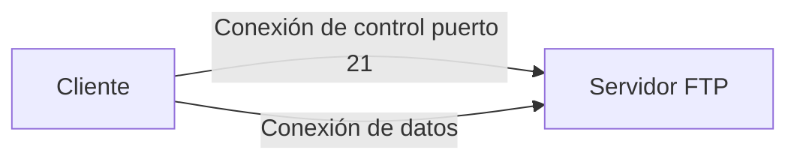

<!-- filepath: /home/lenovo-carles/GithubDAW/Apuntes-Despliegue-de-Aplicaciones-Web/docs/UD06 - Servidores de transferencia de archivos/2. FTP.md -->
# FTP (File Transfer Protocol)

**FTP** es uno de los protocolos más antiguos de internet, diseñado para transferir ficheros entre un cliente y un servidor.

## Características

- Utiliza **dos conexiones**: una de control (puerto 21) y otra de datos (puerto 20 o dinámico en modo pasivo).
- Puede funcionar en **modo activo** o **modo pasivo**.
- Las credenciales y los datos viajan **sin cifrar** (texto plano), por lo que no es recomendable para entornos que requieran seguridad.

## Modo activo vs modo pasivo



- **Modo activo**: el servidor inicia la conexión de datos hacia el cliente (problemas con firewalls/NAT).
- **Modo pasivo**: el cliente inicia también la conexión de datos (más compatible con firewalls).

## Instalación de un servidor FTP (vsftpd) en Debian/Ubuntu

```bash
sudo apt update
sudo apt install vsftpd -y
sudo systemctl enable --now vsftpd
```

## Configuración básica

Fichero `/etc/vsftpd.conf`:

```text
anonymous_enable=NO
local_enable=YES
write_enable=YES
pasv_enable=YES
pasv_min_port=40000
pasv_max_port=40100
```

Reiniciar el servicio:

```bash
sudo systemctl restart vsftpd
```

## Cliente FTP básico

```bash
ftp miservidor.com
```

!!! warning
    Debido a que FTP no cifra la información, en entornos de producción se recomienda usar **SFTP** o **FTPS** en su lugar.
