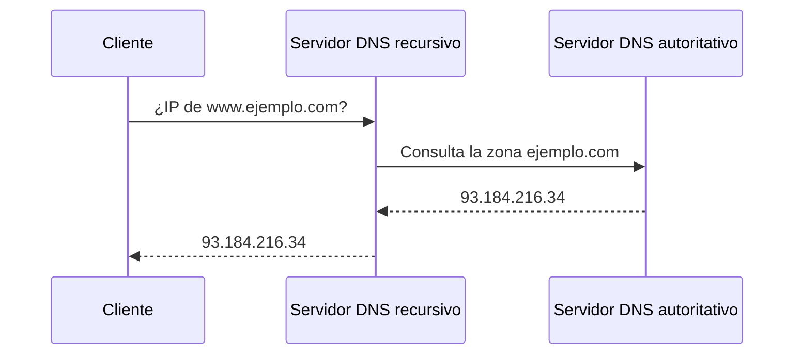

<!-- filepath: /home/lenovo-carles/GithubDAW/Apuntes-Despliegue-de-Aplicaciones-Web/docs/UD07 - Servicios red implicados en el despliegue de una aplicación Web/2. DNS.md -->
# DNS (Domain Name System)

El **DNS** es el servicio encargado de traducir nombres de dominio (`www.ejemplo.com`) en direcciones IP, necesarias para que los clientes puedan conectarse a los servidores.

## Funcionamiento básico



## Principales tipos de registros

| Registro | Descripción                              |
|----------|---------------------------------------------|
| A        | Asocia un dominio a una IPv4                 |
| AAAA     | Asocia un dominio a una IPv6                 |
| CNAME    | Alias de un dominio hacia otro dominio       |
| MX       | Servidor de correo asociado al dominio       |
| NS       | Servidores de nombres autoritativos          |
| TXT      | Información de texto (verificaciones, SPF...) |

## Instalación de un servidor DNS (BIND9) en Debian/Ubuntu

```bash
sudo apt update
sudo apt install bind9 -y
```

## Consultar registros DNS

```bash
dig www.ejemplo.com
nslookup www.ejemplo.com
```
