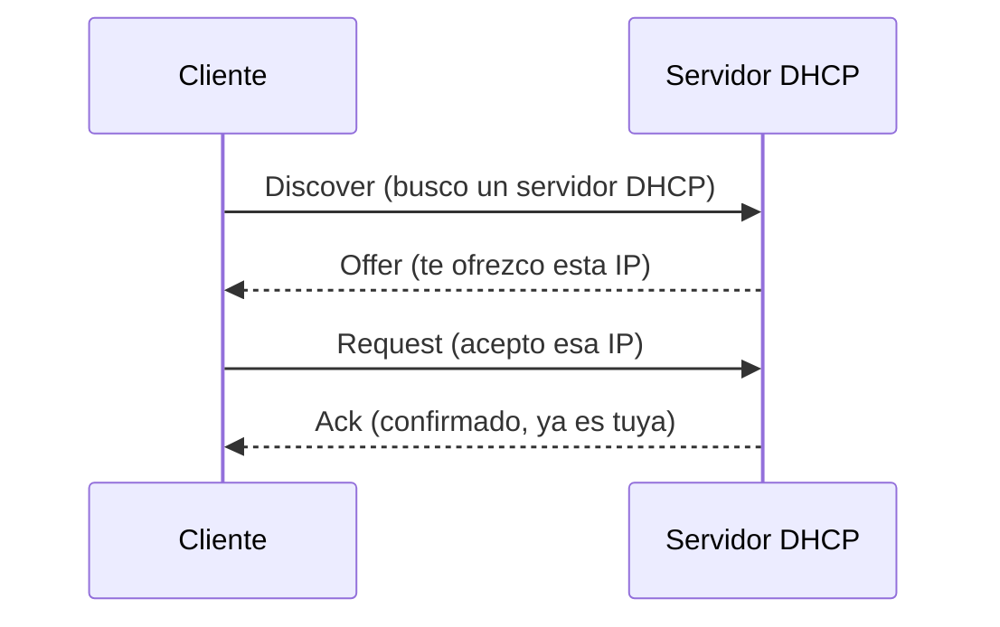

<!-- filepath: /home/lenovo-carles/GithubDAW/Apuntes-Despliegue-de-Aplicaciones-Web/docs/UD07 - Servicios red implicados en el despliegue de una aplicación Web/3. DHCP.md -->
# DHCP (Dynamic Host Configuration Protocol)

**DHCP** es el protocolo encargado de asignar automáticamente direcciones IP y otros parámetros de red (puerta de enlace, DNS...) a los equipos de una red.

## Funcionamiento: DORA



- **Discover**: el cliente, sin IP todavía, pregunta por difusión si hay algún servidor DHCP disponible.
- **Offer**: el servidor le ofrece una IP disponible junto con otros parámetros (máscara, puerta de enlace, DNS).
- **Request**: el cliente solicita formalmente esa IP.
- **Ack**: el servidor confirma la asignación.

## Instalación de un servidor DHCP (isc-dhcp-server) en Debian/Ubuntu

```bash
sudo apt update
sudo apt install isc-dhcp-server -y
```

## Ejemplo de configuración básica (`/etc/dhcp/dhcpd.conf`)

```text
subnet 192.168.1.0 netmask 255.255.255.0 {
  range 192.168.1.100 192.168.1.200;
  option routers 192.168.1.1;
  option domain-name-servers 8.8.8.8, 8.8.4.4;
}
```
