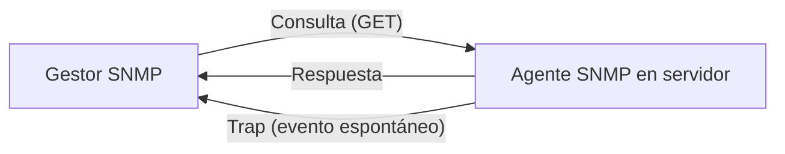

<!-- filepath: /home/lenovo-carles/GithubDAW/Apuntes-Despliegue-de-Aplicaciones-Web/docs/UD07 - Servicios red implicados en el despliegue de una aplicación Web/5. SNMP.md -->
# SNMP (Simple Network Management Protocol)

**SNMP** es un protocolo utilizado para **monitorizar y gestionar** dispositivos de red (routers, switches, servidores...) de forma remota.

## Componentes principales

- **Agente SNMP**: software instalado en el dispositivo monitorizado, que expone información a través de una base de datos **MIB** (*Management Information Base*).
- **Gestor/Manager SNMP**: sistema que consulta periódicamente a los agentes (por ejemplo, Zabbix, Nagios, PRTG).
- **Traps**: notificaciones que el agente envía de forma espontánea al gestor ante un evento (p. ej. caída de un servicio).



## Instalación del agente SNMP en Debian/Ubuntu

```bash
sudo apt update
sudo apt install snmpd snmp -y
```

## Consultar información SNMP de un dispositivo

```bash
snmpwalk -v2c -c public localhost
```

## Versiones de SNMP

| Versión | Seguridad                     |
|---------|----------------------------------|
| SNMPv1  | Sin cifrado, autenticación básica |
| SNMPv2c | Similar a v1, algo más de funciones |
| SNMPv3  | Autenticación y cifrado robustos  |
