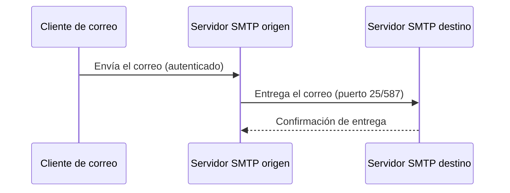

<!-- filepath: /home/lenovo-carles/GithubDAW/Apuntes-Despliegue-de-Aplicaciones-Web/docs/UD07 - Servicios red implicados en el despliegue de una aplicación Web/6. SMTP.md -->
# SMTP (Simple Mail Transfer Protocol)

**SMTP** es el protocolo utilizado para el **envío** de correo electrónico entre servidores y desde clientes hacia servidores.

## Funcionamiento básico



## Puertos habituales

| Puerto | Uso                                   |
|--------|------------------------------------------|
| 25     | Comunicación entre servidores SMTP       |
| 587    | Envío autenticado desde clientes (STARTTLS) |
| 465    | SMTP sobre SSL/TLS (SMTPS)                |

## Instalación de un servidor SMTP básico (Postfix)

```bash
sudo apt update
sudo apt install postfix -y
```

Durante la instalación, selecciona **"Internet Site"** e indica el nombre de dominio del servidor.

## Enviar un correo de prueba desde la terminal

```bash
echo "Cuerpo del mensaje" | mail -s "Asunto de prueba" destinatario@ejemplo.com
```
